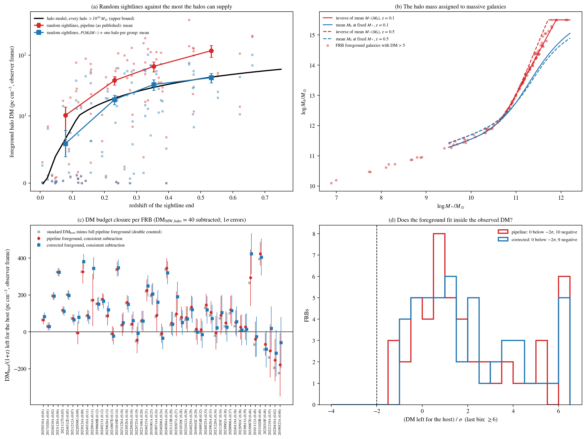

# Audit of the foreground-halo DM and of the DM budget it implies

Generated by `scripts/foreground_audit.py`. It recomputes every FRB sightline and every random control sightline offline, from the cached catalogues in `../ls_cache/`. The recomputed totals reproduce `foreground_dm_per_host.csv` to within the Monte Carlo noise. The per-FRB picture after the audit is `../foreground_diagnostic.png`. Numbers are in `calibration.csv`, `budget.csv`, `frb_vs_random.csv`, `correlation_impact.csv`, `sightlines.csv` and `galaxies.csv`.

## Summary

1. **Subtracting both the full foreground and $\langle{\rm DM_{cosmic}}\rangle$ is not physical.** The Macquart mean counts all diffuse baryons ($f_d = 0.844$), and that includes the gas in galaxy halos. Removing a sightline's full halo DM on top of it counts the average halo contribution twice. The earlier diagnostic and the `dm_host_fg` column did exactly this.
2. **The foreground never exceeded the observed DM.** The largest share was 44% (FRB 20220914A) in the published pipeline, and 19% after the audit. For 6 FRBs it exceeded what is left after subtracting $\langle{\rm DM_{cosmic}}\rangle$. That is the double counting of point 1, combined with point 3.
3. **The published foreground estimate is too large by a factor of 2.2.** Along random sightlines it gives 2.24 (2.00–2.49) times the most that the halos can physically supply with the same gas profile. The main causes are:
   - the way halo masses are assigned to massive galaxies (up to $10^{15.5}\,M_\odot$ for a single galaxy);
   - counting a separate halo for every galaxy of a group;
   - counting the host's own environment as foreground.

   The corrected estimate sits at the physical bound (1.01, 0.91–1.11).
4. **After both fixes, every FRB's DM budget closes.**
   - No FRB is more than $1\sigma$ short ($-0.9\sigma$ at worst; $-1.7\sigma$ with a deliberately small diffuse-gas scatter).
   - Three $\mathrm{DM_{host}}$ values are below zero, against one with the standard estimate.
   - Those three are sightlines whose total extragalactic DM is already at or below the cosmic mean. A difference of noisy terms can be negative; only a significantly negative value would be unphysical, and there is none.
5. **The paper's conclusions do not change.**
   - $\mathrm{DM_{host}}$ vs $q$ is null in every version.
   - $\mathrm{DM_{host}}$–$\lvert{\rm RM}\rvert$ survives every version.
   - The high-$z$ $\mathrm{DM_{host}}$–SFR correlation was weakened by the inflated foreground ($+0.55$). With the corrected one it stays at $+0.73$ to $+0.75$ ($p \le 0.002$).

## 1. What may be subtracted

The observed DM is

$$\mathrm{DM} = \mathrm{DM_{MW,ISM}} + \mathrm{DM_{MW,halo}} + \mathrm{DM_{cosmic}} + \frac{\mathrm{DM_{host}}}{1+z}, \qquad \mathrm{DM_{cosmic}} = \mathrm{DM_{diffuse}} + \mathrm{DM_{halos}}.$$

The Macquart relation predicts the mean, $\langle\mathrm{DM_{cosmic}}\rangle$, from all diffuse baryons. Halo gas is part of it. When the halo term of a particular sightline, $\mathrm{DM_{fg}}$, is estimated, the expected remainder is $\langle\mathrm{DM_{cosmic}}\rangle - \langle\mathrm{DM_{fg}}\rangle(z)$. Here $\langle\mathrm{DM_{fg}}\rangle(z)$ is the mean of the same estimator over random sightlines to the same redshift. The consistent host term is therefore

$$\frac{\mathrm{DM_{host}}}{1+z} = \mathrm{DM} - \mathrm{DM_{MW}} - \left[\langle\mathrm{DM_{cosmic}}\rangle - \langle\mathrm{DM_{fg}}\rangle(z)\right] - \mathrm{DM_{fg}}.$$

Only the excess $\mathrm{DM_{fg}} - \langle\mathrm{DM_{fg}}\rangle(z)$ is new information.

The standard estimate (the paper's Table 1) subtracts the median of the Macquart distribution instead of the mean, and no Milky Way halo term. The median is the cosmic DM of a typical sightline. It lies 2–120 pc cm$^{-3}$ (rest frame, rising with $z$) below the mean, because a few sightlines that cross massive halos pull the mean up. With the halo term measured, the mean is the right reference for the remainder. This choice matters for trends with $z$ (Section 5).

## 2. Is the foreground estimate physically possible?

Along random sightlines, the mean foreground DM must equal the mean electron density in halo gas integrated to the source redshift, whatever the clustering. For the gas profile used by `foreground_halo_dm.py`, this mean follows from the halo mass function (Tinker et al. 2008). The ingredients are the same modified NFW profile, $f_{\rm gas} = 0.75$, Dutton & Macciò concentrations and truncation at $r_{200}$. Counting every halo above $10^{10}\,M_\odot$ once gives an upper bound, since the Legacy Survey sees only part of them. The bound is 7–9% of the mean diffuse electron density at $z = 0.1$–0.5.

| $z$ | Random sightlines, published pipeline | Halo model, every halo $> 10^{10}\,M_\odot$ |
|---|---|---|
| 0.08 | $10 \pm 4$ | 6.6 |
| 0.23 | $38 \pm 6$ | 19.5 |
| 0.35 | $66 \pm 12$ | 29.5 |
| 0.53 | $119 \pm 27$ | 43.6 |

The published estimator exceeds the physical maximum by a factor of 2.24 (16–84%: 2.00–2.49). To find out why, the audit recomputes every galaxy with one assumption changed at a time:

| Variant | Ratio to the halo-model bound |
|---|---|
| Published pipeline | 2.24 (2.00–2.49) |
| No stellar-mass scatter | 2.15 (1.91–2.37) |
| One halo per group | 1.66 (1.50–1.83) |
| Halo mass from $P(M_h \mid M_*)$ | 1.44 (1.29–1.59) |
| $P(M_h \mid M_*)$ and one halo per group (corrected) | 1.01 (0.91–1.11) |

**Halo masses of massive galaxies.**
- The pipeline converts stellar mass to halo mass by inverting the mean Moster et al. (2013) relation $M_*(M_h)$.
- Above $\log M_* \approx 11$ that relation flattens to $M_* \propto M_h^{0.3}$, so its inverse rises steeply. A galaxy with $\log M_* = 11.9$ at $z = 0.2$ is assigned $\log M_h = 15.5$: a Coma-sized cluster with $r_{200} = 2.9$ Mpc, sitting at the edge of the code's mass grid.
- Massive halos are rare, so the halo mass of a galaxy of given stellar mass is much lower. The correct quantity is the distribution $P(M_h \mid M_*) \propto ({\rm d}n/{\rm d}\ln M_h)\,\mathcal{N}(\log M_*;\,\log M_*^{\rm Moster}(M_h),\,0.15)$.
- Its mean is 0.3 dex below the inverse at $\log M_* = 11$, and 0.5–0.9 dex below it at $\log M_* = 11.5$–11.9 (panel b).
- The large published totals are dominated by exactly such galaxies: $\log M_* = 11.5$–12.1, 100–300″ from the sightline.

**One halo per group.**
- The pipeline gives every galaxy its own gas halo. In a group, the satellites' halos overlap the central's, and the halo mass function counts the group once.
- Examples: FRB 20221219A has two galaxies at 195″ and $z \approx 0.13$–0.15; FRB 20220914A has two at $z \approx 0.107$.
- The corrected estimate treats a galaxy as a satellite if it lies inside $r_{200}$ of a more massive candidate at a consistent redshift. Consistent means within the combined photo-$z$ error, or within 1500 km s$^{-1}$ for spectroscopic redshifts.

**Host environment.** Galaxies at the host redshift inside the host's own halo are part of the host system, not foreground (mean 5.5 pc cm$^{-3}$ per FRB). For FRB 20191001A most of the published value is of this kind: 34 becomes 7.

**Not the cause:** the 0.15 dex stellar-mass scatter (2.24 → 2.15).

**Corrected estimate.** It matches the bound (1.01), so it is physically allowed. Saturating the bound also means that the survey sees essentially all the halo gas that matters, which is plausible because massive halos dominate the gas mass. Over the 49 FRBs:
- the median foreground DM falls from 46 to 18 pc cm$^{-3}$;
- FRBs above 100 fall from 13 to 3;
- the median share of the standard $\mathrm{DM_{host}}$ falls from 24% to 7%.

Panel (d) of `../foreground_diagnostic.png` shows how much each cause removed for each FRB.

**Remaining caveats.**
- The calibration is relative to the coded gas profile. A profile with more gas, or extending beyond $r_{200}$, raises both the estimate and the bound together.
- Photo-$z$ draws that reach $z \to 0$ turn a few distant galaxies into nearby dwarfs on the sightline. The calibration includes this net effect.
- The comparison rests on 97 random sightlines.

## 3. Does the foreground fit inside the observed DM?

The budget closure is the second equation of Section 1. Here it includes $\mathrm{DM_{MW,halo}} = 40 \pm 20$ pc cm$^{-3}$ (the paper subtracts none), so the test is stricter than the paper's convention. The uncertainty combines:
- 20% on NE2001;
- the scatter of the diffuse cosmic gas: the half-width of the 16–84% range of the Macquart distribution ($F = 0.2$), with the random-sightline variance of the halo term removed, and at least 10% of the mean;
- 50% on the foreground;
- 20 pc cm$^{-3}$ on the Milky Way halo.

| | Published foreground | Corrected foreground |
|---|---|---|
| FRBs more than $2\sigma$ short | 0 | 0 |
| Most negative $(\text{host term})/\sigma$ | $-1.3$ (FRB 20220418A) | $-0.9$; $-1.7$ with only a 10% diffuse scatter |
| $\mathrm{DM_{host}} < 0$, paper convention (no MW halo) | 6 | 3 |
| $\mathrm{DM_{host}} < 0$, with the MW halo subtracted | 10 | 9 |
| $\mathrm{DM_{host}} < 0$ with the standard estimate | 1 (FRB 20220310F) | |

The three negative corrected values are FRB 20220310F, FRB 20220418A and FRB 20190523A. Their $\mathrm{DM} - \mathrm{DM_{MW}}$ is 416, 587 and 724 pc cm$^{-3}$, against $\langle\mathrm{DM_{cosmic}}\rangle$ = 485, 638 and 679. These sightlines carry less diffuse gas than average: the median sightline lies below the mean, so this is common. Any foreground term pushes such sightlines further down.

With an uncertainty of 110–140 pc cm$^{-3}$ at $z \approx 0.5$–0.7, mostly from the cosmic-gas scatter, values down to about $-100$ are expected occasionally. Four FRBs fall below zero once the Milky Way halo is subtracted, even with no foreground at all and the standard median reference: FRB 20210807D, FRB 20240208A, FRB 20220310F and FRB 20220418A. The true $\mathrm{DM_{host}}$ cannot be negative, but its estimate can. A significant negative value would signal an error, and none occurs.

## 4. Are FRB sightlines typical?

Each sightline's foreground is divided by the halo-model mean at its redshift:
- FRB sightlines carry 1.67 times the random-sightline mean with the corrected estimate (4.0 vs 2.1 times with the published one);
- the permutation test on the means gives $p = 0.009$, and AD gives $p = 0.09$.

The excess is driven by a handful of FRBs (FRB 20230907D, FRB 20221219A, FRB 20190523A, FRB 20220914A, FRB 20230307A, FRB 20211203C). It sits in galaxies clearly in front of the host, at least $2\sigma$ below the host redshift, not in structure at the host redshift. This sightline-specific excess is what the consistent subtraction removes.

## 5. Effect on the correlations

Spearman $r_S$ ($p$), with AD $p$ in brackets:

| Pair | Standard | Full published foreground removed | Standard minus corrected excess | Corrected, consistent |
|---|---|---|---|---|
| DM$_{\rm host}$ vs $q$ (49) | $-0.06$ (0.68) [0.46] | $-0.04$ (0.76) [0.68] | $-0.09$ (0.54) [0.36] | $-0.04$ (0.76) [0.43] |
| DM$_{\rm host}$ vs SFR, $z > 0.29$ (15) | $+0.84$ (<0.001) [0.003] | $+0.55$ (0.035) [0.16] | $+0.75$ (0.001) [0.011] | $+0.73$ (0.002) [0.009] |
| DM$_{\rm host}$ vs SFR, all (42) | $+0.17$ (0.28) [0.06] | $+0.14$ (0.38) [0.52] | $+0.16$ (0.31) [0.09] | $+0.10$ (0.52) [0.21] |
| DM$_{\rm host}$ vs $\lvert{\rm RM}\rvert$ (35) | $+0.48$ (0.004) [0.017] | $+0.52$ (0.001) [0.004] | $+0.54$ (0.001) [0.007] | $+0.53$ (0.001) [0.009] |
| DM$_{\rm host}$ vs $M_*$ (47) | $-0.01$ (0.97) [0.96] | $-0.09$ (0.54) [0.91] | $-0.03$ (0.84) [0.93] | $-0.09$ (0.55) [0.96] |
| DM$_{\rm host}$ vs $z$ (49) | $-0.04$ (0.77) [0.66] | $-0.35$ (0.014) [0.03] | $-0.10$ (0.48) [0.60] | $-0.33$ (0.023) [0.03] |

- **Inclination:** null in every version.
- **$\lvert{\rm RM}\rvert$:** survives every version.
- **High-$z$ SFR:** survives the corrected foreground. The published foreground had weakened it.
- **DM$_{\rm host}$–$z$:** the trend in the consistent version comes from the mean-versus-median reference. The shift $(\langle\mathrm{DM_{cosmic}}\rangle - \text{median})(1+z)$ grows with $z$, and keeping the median reference and removing only the corrected excess leaves $-0.10$ ($p = 0.48$). The trend is therefore a convention, not a result. If real, it would match the expected DM selection against high-DM bursts at high $z$.

## 6. Recommendations

- **Never subtract the full foreground on top of $\langle\mathrm{DM_{cosmic}}\rangle$ or its median.** Subtract only the excess over random sightlines.
- **Replace the published estimator with the corrected one.** In `foreground_halo_dm.py` that means drawing the halo mass from $P(M_h \mid M_*)$, keeping one halo per group, and treating the host environment as host. Then rerun the downstream products (`robust_correlations.py` and the major summary).
- **Use "standard minus corrected excess" for correlation tests.** It keeps the paper's median convention and induces no trend with $z$.
- **Use the consistent (mean-based) form for budget checks.**
