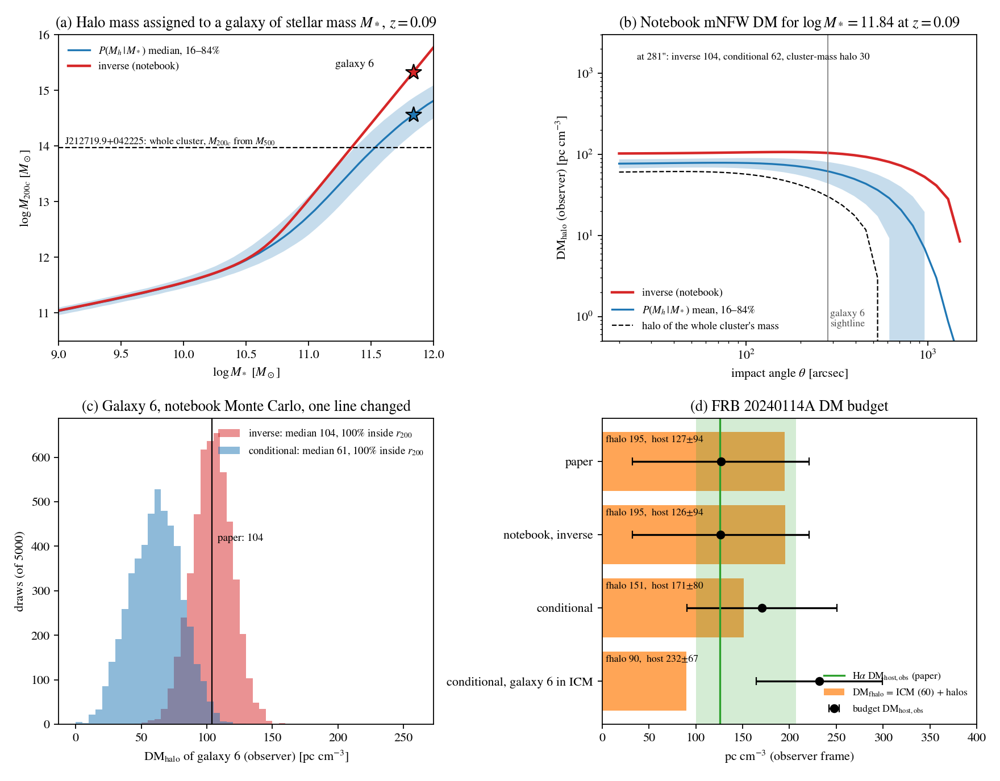

# Halo-mass inversion test (Bhardwaj et al. 2025, FRB 20240114A)

Generated by `scripts/mass_inversion_test.py`.

## What was run

The functions of `Estimate_DM_halo.ipynb` (cell 26, the calculation behind Table 5 of arXiv:2506.11915) are executed unchanged: `stellarmass_from_halomass` (Moster+13), `halomass_from_stellarmass`, `concentration_index`, `ModifiedNFW`, plus the Taylor stellar masses, 0.1 dex systematic and Monte Carlo loop of its main block. On its own inputs it returns 104.2 pc cm$^{-3}$ for Galaxy 6 (Table 5: 104).

One line differs between the two columns below, the halo mass given to each stellar-mass draw:

- **inverse** (notebook and paper): `logMh = halomass_from_stellarmass(logM*, z)`, the halo whose *average* galaxy has stellar mass $M_*$;
- **conditional**: $\log M_h$ drawn from $P(M_h\,|\,M_*) \propto \frac{dn}{d\ln M_h}\,\mathcal{N}\!\left(\log M_*;\ \log M_*^{\rm Moster}(M_h),\ 0.15\right)$, the halo masses of galaxies *of* stellar mass $M_*$, using the same Moster+13 function and the Tinker+08 halo mass function.

## Why the inverse is biased

Moster et al. fit the mean $\log M_*$ at fixed $M_h$ with 0.15 dex scatter (Moster+10 Fig. 6 shows the relation and its scatter). Above the pivot, $M_* \propto M_h^{\,1-\gamma} \approx M_h^{0.37}$ at $z = 0.09$, so 0.15 dex in $M_*$ corresponds to about 0.4 dex in $M_h$. The halo mass function falls steeply there, so most galaxies of a given high $M_*$ are up-scattered from the far more numerous lower-mass halos. Inverting the mean relation ignores this. The direction and size of the effect are standard:

- Dutton et al. (2010, §2.2): abundance matching gives $\langle\log M_*\rangle(M_h)$ while lensing and satellite kinematics give $\langle M_h\rangle(M_*)$; "at high masses, these two definitions give diverging relations", the latter "giving systematically lower halo masses".
- Behroozi et al. (2010, §5): the averaging direction "can affect the resulting stellar mass fractions, particularly for group- and cluster-scale halo masses".

Halo mass at $z = 0.09$ (`conditional_mass.csv`):

| $\log M_*$ | inverse $\log M_h$ | conditional median (16–84%) |
|---|---|---|
| 10.0 | 11.55 | 11.54 (11.46–11.64) |
| 10.5 | 11.97 | 11.95 (11.80–12.16) |
| 11.0 | 13.04 | 12.75 (12.42–13.11) |
| 11.5 | 14.40 | 13.91 (13.53–14.27) |
| 11.84 (Galaxy 6) | 15.33 | 14.57 (14.26–14.90) |

The two agree below $\log M_* \approx 10.5$, so ordinary foreground galaxies are unaffected. The bias appears only for the most massive galaxies, which carry most of the DM.

## Galaxy 6

- Taylor mass $\log M_* = 11.84$ ($M_i = -23.5$). The inverse gives $\log M_{200c} = 15.33$ ($2.1\times10^{15}\,M_\odot$, Coma-like).
- The paper places Galaxy 6 in J212719.9+042225 ($z = 0.0903$). It lies 86″ (149 kpc) from the cluster centre. The paper's $M_{500} = 6.8\times10^{13}\,M_\odot$ converts to $M_{200c} = 10^{13.97}\,M_\odot$ (Dutton & Macciò c–M). The inverted halo of this one member galaxy is **23 times the measured mass of the whole cluster**.
- With the notebook's profile at 281″: inverse 104, conditional 61 (16–84%: 41–81), and a halo of the whole cluster's mass 30 pc cm$^{-3}$.

Dependence on the assumed scatter (`scatter_sensitivity.csv`; 0 reproduces the inverse):

| scatter in $\log M_*$ at fixed $M_h$ (dex) | 0 | 0.05 | 0.10 | 0.15 | 0.20 | 0.25 |
|---|---|---|---|---|---|---|
| median $\log M_h$ | 15.33 | 15.18 | 14.90 | 14.57 | 14.24 | 13.90 |
| Galaxy 6 DM (pc cm$^{-3}$) | 104 | 96 | 80 | 61 | 43 | 27 |

Only zero scatter reproduces the published value. Moster+13 adopt 0.15 dex, and the high-mass-end constraints reviewed by Wechsler & Tinker (2018) are below 0.2 dex, likely about 0.16 intrinsic. The 0.1 dex measurement error on $\log M_*$ adds to the effective scatter, so 0.15 is conservative.

## FRB 20240114A budget

The photo-z galaxies 2, 3 and 5 (9 + 3 + 3) and the central galaxy (11) are kept at the paper's values; they are faint, where the two methods agree. DM$_{\rm host,obs}$ = 527.72 − (45 + 45 + 116 + DM$_{\rm fhalo}$), with $\sigma_{\rm fore}$ as in the paper (`frb20240114a_budget.csv`).

| case | DM$_{\rm c,halo}$ | DM$_{\rm fhalo}$ | budget DM$_{\rm host,obs}$ | vs H$\alpha$ ($126^{+81}_{-26}$) |
|---|---|---|---|---|
| paper | 135 | 195 | 127 ± 94 | 0.0σ |
| notebook re-run, inverse | 135 | 195 | 126 ± 94 | 0.0σ |
| conditional halo masses | 91 | 151 | 171 ± 80 | 0.4σ |
| conditional, Galaxy 6 not added to the ICM | 30 | 90 | 232 ± 67 | 1.0σ |

The last row counts the cluster once. Galaxy 6 is a bright cluster member. Whether it is the central galaxy or a satellite, its gas is the intracluster medium that DM$_{\rm ICM}$ = 60 already models from the measured cluster mass. Adding its own Moster halo counts that gas a second time.

## What changes in the paper's conclusions

- **The budget host DM rises** from 126 to 171–232 pc cm$^{-3}$. It stays consistent with the H$\alpha$ estimate within 1σ in every case, because the H$\alpha$ upper error is large.
- **The statement that the foreground halo term dominates the DM** (§III.2.4 and Discussion) does not survive. DM$_{\rm fhalo}$ falls from 195 to 90–151, comparable to or below DM$_{\rm IGM}$ = 116 and the host.
- **The method itself is unaffected** apart from the mass assignment for $\log M_* \gtrsim 10.7$ galaxies and the group double count. The selection, profile and Monte Carlo all stay as they are.

## Not changed

- The notebook passes $M$ in $M_\odot$ to Colossus, which expects $M_\odot/h$. That lowers $c$ and the DM by 3–6% (`CODE_CHECKS.md`). It is left as is here, so only the halo-mass line differs.
- The Taylor stellar masses, the 0.1 dex systematic and the 50% systematic on the total are left unchanged.
